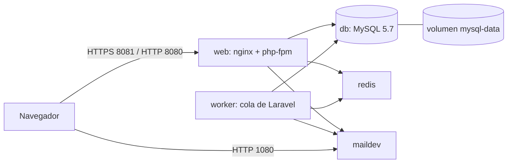
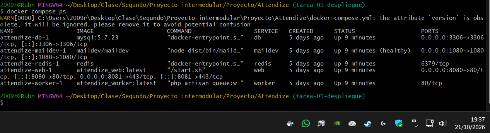
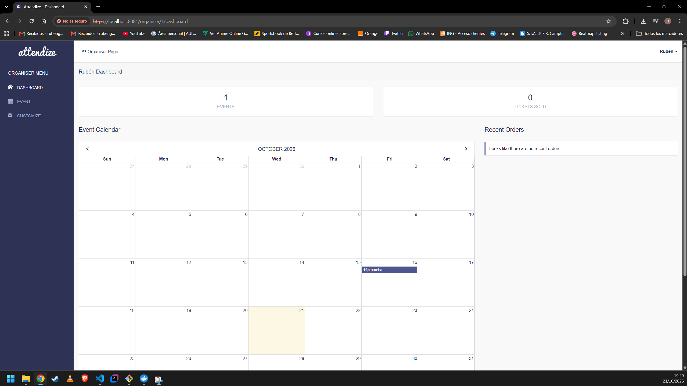
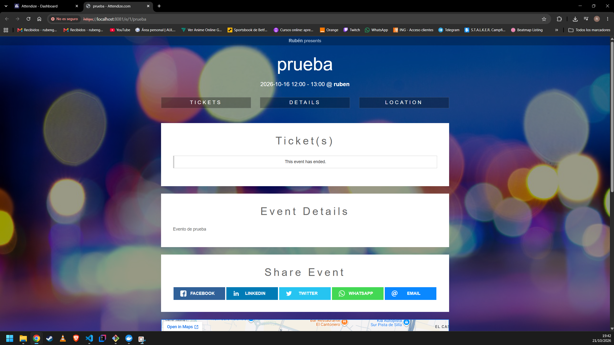
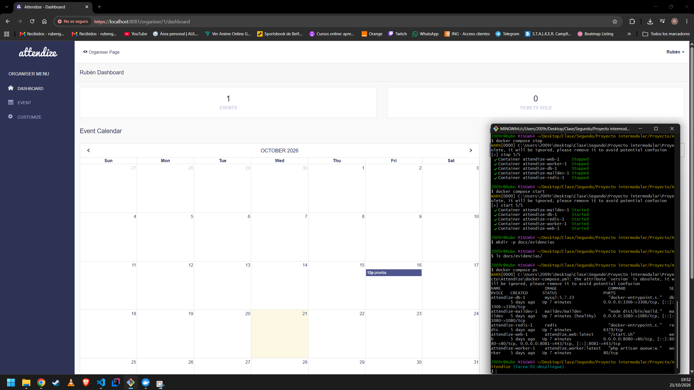

*Attendize* is an open-source ticketing and event management application built using the Laravel PHP framework. Attendize allows event organisers to sell tickets to their events and manage attendees without paying service fees to third party ticketing companies.

<p align="center">
  
  
</p>

# Attendize
Open-source ticket selling and event management platform

> Please report bugs here: https://github.com/Attendize/Attendize/issues. Detailed bug reports are more likely to be looked at. Simple creating an issue and saying "it doesn't work" is not useful. Providing some steps to reproduce your problem as well as details about your operating system, PHP version etc can help.

> Take a look https://www.attendize.com/troubleshooting.html and follow the https://www.attendize.com/getting_started.html guide to make sure you have configured attendize correctly.  

Documentation Website: https://www.attendize.com<br />

## Current Features (v2.X.X)
 - Beautiful mobile friendly event pages
 - Easy attendee management - Refunds, Messaging etc.
 - Data export - attendees list to XLS, CSV etc.
 - Generate print friendly attendee list
 - Ability to manage unlimited organisers / events
 - Manage multiple organisers 
 - Real-time event statistics
 - Customizable event pages
 - Multiple currency support
 - Quick and easy checkout process
 - Customizable tickets - with QR codes, organiser logos etc.
 - Fully brandable - Have your own logos on tickets etc.
 - Affiliate tracking
    - track sales volume / number of visits generated etc.
 - Widget support - embed ticket selling widget into existing websites / WordPress blogs
 - Social sharing 
 - Support multiple payment gateways - Stripe, PayPal & Coinbase so far, with more being added
 - Support for offline payments
 - Refund payments - partial refund & full refunds
 - Ability to add service charge to tickets
 - Messaging - eg. Email all attendees with X ticket
 - Public event listings page for organisers
 - Ability to ask custom questions during checkout
 - Browser based QR code scanner for door management
 - Elegant dashboard for easy management.

## Minimum Requirements

Attendize should run on most pre-configured LAMP or LEMP environments as long as certain requirements are adhered to. Attendize is based on the [Laravel Framework](https://laravel.com/)

**PHP Requirements**
1. PHP >= 7.1.3
2. OpenSSL PHP Extension 
3. PDO PHP Extension 
4. Mbstring PHP Extension 
5. Tokenizer PHP Extension 
6. Fileinfo PHP Extension 
7. GD PHP Extension

**MySQL Requirements**
1. MySQL version 5.7 or higher required

## Contributing
Feel free to fork and contribute. If you are unsure about adding a feature, create a Github issue to ask for Feedback. Read the [contribution guidelines](CONTRIBUTING.md)

## Submitting an issue
If you encounter a bug in Attendize, please first search the list of current open [Issues on the GitHub repository](https://github.com/Attendize/Attendize/issues). You may add additional feedback on an existing bug report. If the issue you're having has not yet been reported, please open a new issue. There is a template available for new issues. Please fill out all information requested in the template so we can help you more easily.

Please note: support is not offered from the project maintainers through GitHub. Paid support is available by [purchasing a license](https://www.attendize.com/license.html).

## Installation
To get developing straight away use the [Pre-configured Docker Environment](https://www.attendize.com/getting_started.html#running-attendize-in-docker-for-development)<br />
To do a manual installation use the [Manual Installation Steps](https://www.attendize.com/getting_started.html#manual-installation)

## Upgrade
To upgrade to a new version:

- we recommend putting your site into [Maintenance Mode](https://laravel.com/docs/6.x/configuration#maintenance-mode) by running `php artisan down` from the root of your installation. This isn't required but can help prevent problems if users are on your site during the upgrade.
- download the latest version of the code from GitHub and copy the code to your server however you normally do so - via FTP, git pull, continuous integration deployment, etc.
- navigate to https://<your-site.com>/upgrade and follow the instructions on screen
- the upgrade page will run database migrations, update configuration settings, etc as needed for the new code version.

## Testing
To run the application tests, you can run the following from your project root:

```sh
# If the testing db does not exist yet, please create it
touch database/database.sqlite
# Run the test suite
./vendor/bin/phpunit
```

This will run the feature tests that hits the database using the `sqlite` database connection.

## Troubleshooting
If you are having problems please read the [troubleshooting guide](https://www.attendize.com/troubleshooting.html) 

## License
Attendize is open-sourced software licensed under the Attribution Assurance License. See [https://www.attendize.com/license.html](https://www.attendize.com/license.html) for further details. We also have white-label license options available.

## Code of Conduct
The Attendize community operates a [Code of Conduct](CODE_OF_CONDUCT.md) to ensure everyone is able to participate comfortably, equally and safely.


# Tarea 01: Despliegue local reproducible de Attendize

Proyecto Intermodular II · 2.º DAW · IES Juan de Garay

## 1. Versión y punto de partida

- Aplicación: [Attendize](https://github.com/Attendize/Attendize), versión **v2.8.0** (Laravel 6, PHP 7.4)
- Repositorio oficial: https://github.com/Attendize/Attendize
- Fork: https://github.com/RubenAmigo/Attendize
- Rama de trabajo: `tarea-01-despliegue`
- Etiqueta de inicio: `tarea-01-inicio` (equivale a `v2.8.0`)
- Etiqueta de entrega: `tarea-01-entrega`

## 2. Requisitos previos

- Git
- Docker Desktop. Versiones utilizadas: Docker 29.8.2 y Docker Compose v5.6.0
- Terminal Bash (en Windows, Git Bash)
- Puertos libres en el equipo: 8080, 8081, 3306 y 1080

## 3. Arquitectura del entorno



### Servicios

| Servicio | Imagen | Puertos (equipo → contenedor) | Función |
|---|---|---|---|
| `web` | `attendize_web:latest` (construida en local) | 8080 → 80, 8081 → 443 | Servidor web (nginx + php-fpm) con la aplicación |
| `worker` | `attendize_worker:latest` (construida en local) | ninguno | Ejecuta en segundo plano la cola de Laravel |
| `db` | `mysql:5.7.23` | 3306 → 3306 | Base de datos MySQL |
| `maildev` | `maildev/maildev` | 1080 → 1080 | Servidor de correo de pruebas con interfaz web |
| `redis` | `redis` | ninguno | Caché y colas |

### Red y volúmenes

- **Red:** la red por defecto de Docker Compose. Los servicios se encuentran por el nombre del
  servicio, por eso `DB_HOST` vale `db`.
- **Volumen `mysql-data`:** guarda los datos de MySQL (`/var/lib/mysql`). Es lo que permite que
  la información se conserve al parar e iniciar los servicios.
- **Montaje del proyecto:** `web` y `worker` montan la carpeta del proyecto en
  `/usr/share/nginx/html` y `/var/www`. Por eso las dependencias (`vendor/`) viven en la
  carpeta local y no en la imagen.

## 4. Variables de entorno

El archivo `.env` **no se sube al repositorio**. Se crea a partir de `.env.example`, que solo
contiene valores ficticios.

| Variable | Descripción | Valor |
|---|---|---|
| `APP_ENV`, `APP_DEBUG` | Entorno y modo depuración | Los de `.env.example` |
| `APP_URL` | Dirección de acceso | `https://localhost:8081` |
| `APP_KEY` | Clave de cifrado de Laravel. **Debe contener una sola clave** | Se genera, ver sección 5 |
| `DB_HOST` | Servicio de base de datos | `db` (nombre del servicio, no `localhost`) |
| `DB_PORT` | Puerto de MySQL | `3306` |
| `DB_DATABASE`, `DB_USERNAME`, `DB_PASSWORD` | Base de datos y credenciales | Valores ficticios de `.env.example` |
| `MAIL_HOST`, `MAIL_PORT` | Servidor de correo de pruebas | `maildev` y `1025` |

## 5. Puesta en marcha desde cero

```bash
git clone https://github.com/RubenAmigo/Attendize.git
cd Attendize
git checkout tarea-01-entrega
cp .env.example .env
```

1. **Construir las imágenes** (el `docker-compose.yml` las usa por nombre, no las construye):

   ```bash
   docker build --tag attendize_base --target base .
   docker build --tag attendize_worker --target worker --cache-from attendize_base:latest .
   docker build --tag attendize_web --target web --cache-from attendize_worker:latest .
   ```

   Aparece el aviso `ERROR importing cache manifest`, que no es fatal (ver sección 8).

2. **Iniciar los servicios y comprobarlos:**

   ```bash
   docker compose up -d
   docker compose ps
   ```

3. **Instalar las dependencias de PHP** (necesario porque el montaje del proyecto oculta el
   `vendor/` de la imagen):

   ```bash
   docker compose exec web composer install
   ```

4. **Revisar `.env`**: este comando puede reescribirlo a partir de `.env.example` y añadir una
   `APP_KEY`. Comprueba que `DB_HOST=db` y que `APP_KEY` contiene **una sola** clave
   `base64:...`. Si hace falta, genera una con:

   ```bash
   echo "base64:$(openssl rand -base64 32)"
   ```

5. **Recrear los contenedores** para que lean el `.env` correcto:

   ```bash
   docker compose up -d --force-recreate
   ```

6. **Preparar MySQL y ejecutar las migraciones** (en una sola línea):

   ```bash
   docker compose exec web sh -c "wait-for-it db:3306 -t 180 && php artisan key:generate && php artisan migrate"
   ```

7. **Completar la instalación** en `https://localhost:8081/install`. Se acepta el aviso del
   certificado local. Los datos de base de datos son los del `.env`; para el correo se usa
   `maildev` (puerto `1025`, sin usuario ni contraseña).

### Órdenes habituales

| Acción | Orden |
|---|---|
| Iniciar | `docker compose up -d` |
| Comprobar estado | `docker compose ps` |
| Ver registros | `docker compose logs web` |
| Detener (conserva datos) | `docker compose stop` |
| Reiniciar | `docker compose start` |

No uses `docker compose down -v`: el `-v` borra el volumen y con él la base de datos.

### Primer acceso

- Aplicación: https://localhost:8081
- Correos de prueba: http://localhost:1080
- Cuenta de administrador creada en el asistente con **datos ficticios**. Las credenciales no se
  publican en este repositorio.

## 6. Archivos Docker utilizados o adaptados

- [`Dockerfile`](Dockerfile): **adaptado** (ver sección 7).
- [`docker-compose.yml`](docker-compose.yml): sin modificar.
- [`Makefile`](Makefile): sin modificar. De él se toman las tres órdenes `docker build`.

## 7. Problemas encontrados, decisiones y soluciones

Se siguió la norma de no cambiar de versión ni descargar una solución ya preparada: cada
fallo se registró, se investigó su causa y se aplicó la adaptación mínima. El registro del
primer error se conserva en [`error-build-base.log`](error-build-base.log).

### Incidencia 1: los repositorios de Debian devuelven 404

**Error**

```
RUN apt-get update && apt-get install -y wait-for-it libxrender1
...
E: The repository 'http://deb.debian.org/debian buster Release' does not have a Release file.
ERROR: ... did not complete successfully: exit code: 100
```

**Causa**

La imagen base `wyveo/nginx-php-fpm:php74` está construida sobre Debian 10 "buster", que ha
llegado al final de su vida útil (EOL). Sus repositorios ya no están en `deb.debian.org` ni
en `security.debian.org` (responden 404) y se encuentran en `archive.debian.org`. Al fallar
`apt-get update`, `apt-get install` no puede continuar. El repositorio de PHP
(`packages.sury.org`) también devolvía 404.

**Decisión y solución**

Mantener la imagen base y apuntar apt al archivo histórico de Debian, quitando la línea
`buster-updates` (que no existe allí) y desactivando la comprobación de caducidad de los
índices antiguos.

### Incidencia 2: clave de firma caducada del repositorio de nginx

**Error**

```
W: GPG error: http://nginx.org/packages/mainline/debian buster InRelease:
The following signatures were invalid: EXPKEYSIG ABF5BD827BD9BF62 nginx signing key
E: The repository 'http://nginx.org/packages/mainline/debian buster InRelease' is not signed.
```

**Causa**

La clave con la que está firmado el repositorio de nginx incluido en la imagen ha caducado,
así que apt lo rechaza y `apt-get update` termina con error. La línea se localizó con:

```
docker run --rm wyveo/nginx-php-fpm:php74 sh -c "grep -rn nginx.org /etc/apt/"
```

Resultado: `/etc/apt/sources.list:7:deb http://nginx.org/packages/mainline/debian/ buster nginx`.

**Decisión y solución**

Eliminar esa línea. Para instalar `wait-for-it` y `libxrender1` no hace falta ese
repositorio, y nginx ya viene instalado en la imagen.

**Cambio resultante en el `Dockerfile` (incidencias 1 y 2)**

```dockerfile
# Antes
RUN apt-get update && apt-get install -y wait-for-it libxrender1

# Después
RUN sed -i 's|deb.debian.org|archive.debian.org|g; s|security.debian.org|archive.debian.org|g; /buster-updates/d; /nginx.org/d' /etc/apt/sources.list \
    && rm -f /etc/apt/sources.list.d/*.list \
    && apt-get -o Acquire::Check-Valid-Until=false update \
    && apt-get install -y wait-for-it libxrender1
```

### Incidencia 3: `./scripts/setup: not found` (exit code 127)

**Error**

```
RUN ./scripts/setup
/bin/sh: 1: ./scripts/setup: not found
ERROR: ... did not complete successfully: exit code: 127
```

**Causa**

El script existe, pero tiene finales de línea de Windows (CRLF), porque Git for Windows
convierte los saltos de línea al clonar (`core.autocrlf=true`). La primera línea queda como
`#!/bin/bash\r` y Linux busca un intérprete llamado `/bin/bash\r`, que no existe. Verificado con:

```
$ file scripts/setup
scripts/setup: Bourne-Again shell script, ASCII text executable, with CRLF line terminators
```

**Decisión y solución**

Normalizar el script a LF dentro del propio `Dockerfile`, para que el build funcione en
cualquier máquina con independencia de la configuración de Git.

```dockerfile
# Antes
RUN ./scripts/setup

# Después
RUN sed -i 's/\r$//' ./scripts/setup && chmod +x ./scripts/setup && ./scripts/setup
```

### Incidencia 4: falta `vendor/autoload.php` al ejecutar `php artisan`

**Error**

```
PHP Fatal error: require(): Failed opening required '/usr/share/nginx/html/vendor/autoload.php'
sh: 2: artisan: not found
```

**Causa**

`docker-compose.yml` monta el directorio del proyecto sobre el del contenedor
(`.:/usr/share/nginx/html`). Ese montaje oculta el `vendor/` que se instaló en la imagen
durante el build, y en el equipo local no existe `vendor/` (verificado con `ls vendor`).

**Decisión y solución**

No modificar el `docker-compose.yml`. Instalar las dependencias desde el contenedor, de modo
que `vendor/` quede en el directorio compartido:

```
docker compose exec web composer install
```

`vendor/` no se sube a Git.

### Incidencia 5: `APP_KEY` con varias claves y el instalador pide la clave en bucle

**Error**

El instalador volvía a pedir generar la clave de Laravel. En `.env`, la línea `APP_KEY`
contenía cinco claves `base64:...` concatenadas, y `printenv APP_KEY` dentro del contenedor
no devolvía nada.

**Causa probable**

El contenedor se creó con `APP_KEY` vacía y no relee el `.env` hasta que se recrea. Cada
generación de clave añadía una nueva en lugar de reemplazar la anterior, con lo que la clave
resultante no era válida.

**Decisión y solución**

Generar una clave con `echo "base64:$(openssl rand -base64 32)"`, dejar una única clave en
`.env` y recrear los contenedores:

```
docker compose up -d --force-recreate
docker compose exec web php artisan config:clear
```

## 8. Limitaciones pendientes

- Al construir `worker` y `web` aparece `ERROR importing cache manifest from attendize_base:latest`.
  Es un aviso no fatal: `--cache-from` busca esa referencia como imagen de un registro remoto y,
  al no encontrarla, Docker continúa sin esa caché. El build termina correctamente.
- Docker Compose avisa de que el atributo `version` de `docker-compose.yml` está obsoleto. Es solo
  una advertencia y no afecta al funcionamiento.
- El servicio `db` define `MYSQL_ROOT_PASSWORD: "yes"` en `docker-compose.yml`. Es una credencial
  de desarrollo sin valor real, pero no es adecuada para un entorno de producción. Además, el
  puerto 3306 está publicado en el equipo.
- La base del `Dockerfile` usa Debian buster (EOL) y PHP 7.4, sin soporte de seguridad. Es
  aceptable para esta práctica local, pero habría que actualizarla en una modernización.
- El `.env` puede ser reescrito por `composer install`, y por eso hay que revisarlo después
  (sección 5, paso 4).

## 9. Evidencias

Todas las comprobaciones se realizaron en local con datos ficticios. Las capturas están en
`docs/evidencias/`.

| Comprobación | Evidencia | Fecha | Commit |
|---|---|---|---|
| Contenedores iniciados | `docs/evidencias/01-compose-ps.png` | 21/10/2026 | `tarea-01-entrega` |
| Acceso por HTTPS | `docs/evidencias/02-acceso.png` | 21/10/2026 | `tarea-01-entrega` |
| Evento ficticio guardado | `docs/evidencias/03-evento.png` | 21/10/2026 | `tarea-01-entrega` |
| Persistencia tras `stop` y `start` | `docs/evidencias/04-persistencia.png` | 21/10/2026 | `tarea-01-entrega` |

El evento ficticio se creó varios días antes de las capturas. Tras cerrar Docker Desktop durante
ese tiempo, el evento seguía disponible, y la captura 04 lo confirma tras `docker compose stop` y
`docker compose start`.






## 10. Seguridad

- `.env` está ignorado por Git y no se sube al repositorio.
- `.env.example` solo contiene nombres de variables y valores ficticios.
- No se han configurado pagos ni servicios externos, y todos los datos son ficticios.